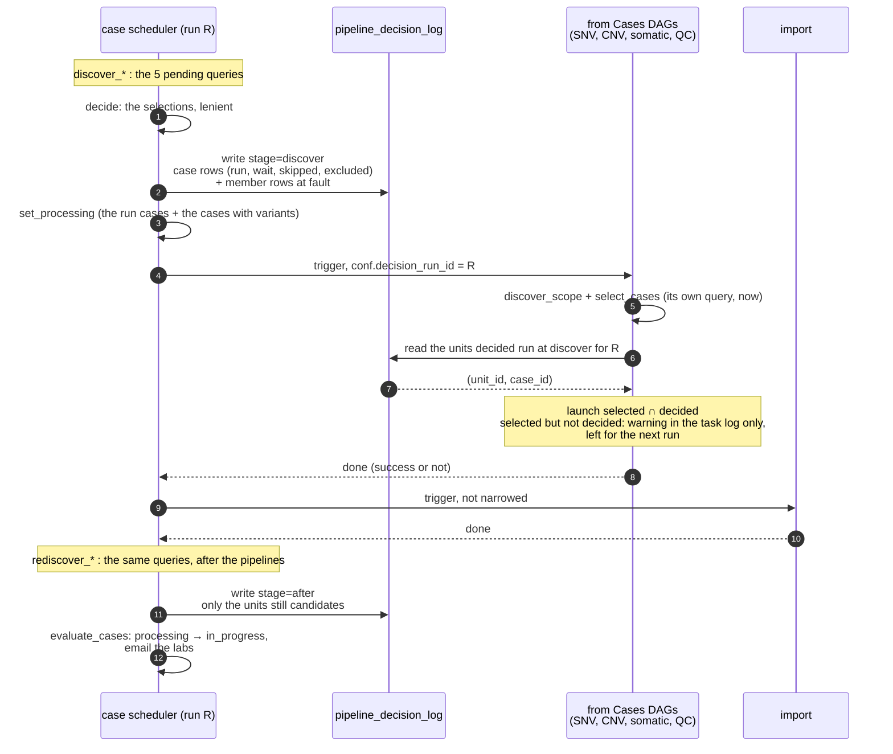

# RAD-288 Common decision schema and pipeline_decision_log

Story [RAD-286](https://ferlab-crsj.atlassian.net/browse/RAD-286), Task 2 of 6. Builds on RAD-287 (shared views). Analysis: <https://claude.ai/artifact/AEBifGKjC9oock66MxHAh3> (step 02).

**Summary:** the case scheduler decides once per run, for every pipeline, which cases `run`, `wait`, are `excluded` or `skipped`, and why, down to the member at fault. It writes these decisions to a StarRocks table, `pipeline_decision_log`. The "from Cases" DAGs it triggers read their cases from that table instead of re-deciding. Which cases run and which statuses move does not change. What changes: the decisions are kept, and they are made in one place.

## 1. Why

- "Why was case X not processed last night?" has no answer today short of reading Airflow logs. Every reason (`pending_alignment`, `no_gvcf`, `proband_count`…) is a `LOGGER.warning` in a task log (`radiant/tasks/nextflow/resolve.py:134-137`). The `excluded` list a DAG returns in XCom is read by nothing.
- Each pending query runs three times per daily run, and the Python selection runs on top of each:
  - the scheduler's `discover_*` (`radiant/dags/case_scheduler.py:109-157`), selected in-process by `cases_with_work` (`radiant/tasks/nextflow/case_status.py:38-61`);
  - each child's `discover_scope`, selected again by its `select_cases`;
  - the scheduler's `rediscover_*` after the pipelines (`case_scheduler.py:355`).
  
  The scheduler and the child read the data at different times. They can disagree, and nothing records it.
- `wait` and `excluded` are not told apart. `pending_sequencing` and `pending_alignment` are transient by comment only. In code they are reasons like `ambiguous_gvcf`.

## 2. What exists today

**The decision is made in two layers.**
- SQL `exclusion_reason` in each pending query (RAD-287 views).
- Python reasons in `radiant/tasks/nextflow/{,cnv/,qc/,somatic/}resolve.py`:
  - `missing_aliquot`, `proband_count`, `unsupported_strategy`;
  - CNV: `unknown_caller`, `unsupported_caller`;
  - somatic: `unsupported_samples`.
- A Python reason can exclude a case that the SQL let through.

**Granularity differs by pipeline.**
- SNV, CNV and QC decide per case: one `ExcludedCase(case_id, reason, detail)`, and the first problem found among the members wins (`resolve.py:65-70, 120-127`).
- Somatic decides per calling task: `ExcludedTask(task_id, case_ids, reason, detail)` (`somatic/resolve.py:55-61`). A task-level problem excludes the task for all its cases. A case-level problem (`no_project_code`, `tenant_excluded`) drops one case.
- QC merges the germline and somatic rows into one selection (`nextflow_quality_control_cases.py:149`).
- Import returns bare `case_id`s (`sql/radiant/import_pending_case_select.sql`), with no reason and no tenant.

**Candidates only.** A pending query returns the cases with work to consider. A case already done, or with no trigger document, is not returned (`candidate` CTE). So "done" today means "not returned".

**What the scheduler does with the selection** (`case_status.py`):
- Cases that `run` in at least one pipeline, plus the cases with variants, move `submitted → processing` (`plan_processing`).
- After the pipelines, a `processing` case leaves for `in_progress` when the second discovery has nothing to run for it and it has variants (`plan_in_progress`).
- A case whose only blocker is `wait` (e.g. `pending_alignment`) does not count as "work waiting" today.

**Nothing in the ETL writes a log table.** The pattern to reuse for writing rows is `executemany` over a list of dicts, as `insert_new_sequencing_experiment` does (`radiant/dags/import_radiant.py:75-103`, `sql/radiant/sequencing_experiment_insert.sql`). No init table uses TTL or dynamic partitions.

**Run identity.** The scheduler's `run_id` (`scheduled__…` / `manual__…`). Every child runs as `sanitize_run_tag(run_id)` (`radiant/tasks/nextflow/paths.py:17-29`), so a child run maps back to its scheduler run.

## 3. Options

- **A. The scheduler decides and writes; children read (chosen).** One decision per run and per pipeline, written by the scheduler. A child triggered by the scheduler runs on the cases decided `run`.
  - Pros: one place decides; the log is what actually happened; the scheduler and the child cannot disagree silently.
  - Cons: the children change (a new param, and a narrowed discover).
- **B. Each child writes its own decisions.** The scheduler reads the log after the pipelines.
  - Pros: the smallest change.
  - Cons: the queries still run twice before the pipelines, and the two passes can still diverge.
- **C. Log only.** The scheduler writes what it sees; nothing reads it.
  - Pros: the simplest.
  - Cons: leaves "the scheduler reads the decisions" undone, and the replays stay.

## 4. Design

### Decision model

New module `radiant/tasks/nextflow/decision.py`.

**Two levels, one model.** A decision is about a case, or about one member of it:
- **case row** (`scope = 'case'`): the decision of the case for the pipeline. Every candidate case has exactly one per pipeline and stage (per calling task for `somatic_snv`, told apart by `unit_id`).
- **member row** (`scope = 'member'`): one per member at fault, with its own reason. A trio whose father is `pending_alignment` and mother `ambiguous_gvcf` gives one case row and two member rows. A case that runs has no member row.

**The `Decision` model:**
- `pipeline`: `germline_snv` | `germline_cnv` | `somatic_snv` | `qc` | `import`;
- `scope`: `case` | `member`;
- `case_id`, `tenant_code`;
- `patient_id`: the member at fault, NULL on the case row and for a case-level reason (`proband_count`, `unsupported_strategy`, `no_project_code`, `tenant_excluded`);
- `seq_id`: the member's current experiment, NULL when there is none yet (`pending_sequencing`) or on the case row;
- `task_id`: on a member row, the member's current alignment task when it has one, so the document at fault can be found at the source;
- `unit_id`: the calling task for `somatic_snv`, NULL otherwise;
- `decision`: `run` | `wait` | `excluded` | `skipped`;
- `reason` (NULL for `run`) and `detail` (the readable text the `REASON_TEXT` dicts already build).

**Decision from the reason.** One function, two constant sets next to it:
- no reason → `run`;
- transient, the data will come by itself: `pending_sequencing`, `pending_alignment` → `wait`;
- deliberate, by configuration: `tenant_excluded` → `skipped`;
- every other reason → `excluded`: something needs fixing (a document, a case in the portal, or an unsupported upstream pipeline).

`excluded` is therefore always "someone has to act", and `tenant_excluded` does not drown the real problems every day.

**The case decision from its members.** `excluded` if any reason is `excluded`; else `skipped` if any is `skipped`; else `wait` if any is `wait`; else `run`. The case row's `reason` is the reason of the first member row with that decision (proband first, as today's ordering).

**Each selection returns its decisions.** The four `_validate` functions (`resolve.py:171`, `cnv/resolve.py:138`, `qc/resolve.py:140`, `somatic/resolve.py:188`) already collect every problem of a case; they return the member (`patient_id`, `seq_id`) with each one. An adapter over each `Selection` builds:
- one case row per candidate case (per case of each calling task for somatic);
- one member row per problem that names a member;
- `tenant_code` from the candidate rows.

The selection rules do not change: a case with any problem still does not run.

**Import.** `import_pending_case_select.sql` gains `tenant_code` and a `reason`, taken from the branch that matched:
- `new_or_changed`: in the delta view;
- `not_loaded`: `updated_at >= ingested_at`;
- `deleted`.

Every import row is a `run`.

### Table `pipeline_decision_log`

**Location.** Base database, mapping key `starrocks_pipeline_decision_log`, created by `radiant/dags/sql/radiant/init/pipeline_decision_log_create_table.sql`, listed in `_BASE_TABLES`.

**Columns:**
- `run_id` VARCHAR: the scheduler run, sanitized like the child run ids;
- `stage` VARCHAR: `discover` | `after` (see Flow);
- `pipeline`, `scope`, `case_id`, `tenant_code`, `patient_id`, `seq_id`, `task_id`, `unit_id`;
- `decision`, `reason`, `detail`;
- `decided_at` DATETIME.

**Storage.** `DUPLICATE KEY(run_id, stage, pipeline, case_id)`, `PARTITION BY date_trunc('day', decided_at)`. Append-only: a run never updates a row.

**A log of changes.** A pass writes:
- every `run`: the work of this pass, which the "from Cases" DAGs and the scheduler read back for the current run;
- any other decision only when the unit's rows differ from its last state (`scope`, member, experiment, task, decision, reason; not the `detail`).

A unit that keeps its decision writes nothing, so the table grows with the changes and the work, not with the number of cases (100 000 are expected): no retention. One `decided_at` per pass, set by `write_decisions`.

**State view `case_pipeline_state`.** The rows of each unit's last write (pipeline, case, calling task for somatic): its current state until the next change. `write_decisions` reads it to tell what changed; an operator reads it to see where a case stands. Created by Init StarRocks Base Tables, after the table.

### Flow

What one daily scheduler run `R` writes to and reads from the log:



Reading a unit's rows for one run:

- `run` at `discover`, absent at `after`: the pipeline ran it, it is no longer a candidate.
- `run` at `discover`, `run` again at `after`: the pipeline failed on it, or the child did not launch it.
- `wait`, `skipped` or `excluded` at `discover`: not launched; the member rows say who is at fault. The `after` row usually repeats it.
- absent at `discover`, `run` at `after`: it became runnable during the run; the child left it for the next run (see its warning).
- no `discover` row at all for `R`: `discover_cases` failed, and the children launched nothing.
- no `after` row at all for `R`: the second discovery did not run (a failed import, CNV post-processing or QC), so an absence there means nothing.

**1. `decide` (scheduler, stage `discover`).**
- Replaces the selection inside `cases_with_work`.
- Reads the five `discover_*` row lists, runs the four selections (lenient, as today) and the import adapter.
- Writes the decisions (every `run`, the others on change), then returns the `run` case ids per pipeline (the somatic `run` task ids too).
- `plan_processing` uses the union, as today.

**2. Children triggered by the scheduler.**
- Their `conf` gains `decision_run_id`.
- Their discover query and their selection run as today: the child needs the members' rows and URLs anyway.
- Then they keep only the units decided `run` at `discover` for that run, read from the log: the case for the germline pipelines and QC, the (calling task, case) pair for somatic. A case only filter would not do for somatic: a case can have two calling tasks (tumor-normal and tumor-only), and a task that arrived after `decide` would run without having been decided.
- A unit the child could run but that was not decided is dropped with a warning, and decided by the next run. A unit decided `run` that the child now excludes (data changed since `decide`) does not run; the `after` pass logs its new state.
- The children read the log, they do not write it: the `after` pass already shows what a child did not run, and a write in each child would be one more way for a launch to fail. No SQL query changes.

**3. Manual runs.**
- A child run by hand (no `decision_run_id`) launches its whole selection, as today; with `task_ids` it keeps its strict path. It writes nothing to the log.

**4. Import.** Not narrowed. It loads the annotations the other children register during the same run, so `decide` cannot know its full work. It keeps its own delta logic. Its decisions are logged at `discover` and `after`.

**5. `after` (scheduler).**
- `rediscover_*` stays, because the state has changed: the pipelines ran.
- Its selection goes through the same adapter and is written with stage `after`.
- `plan_in_progress` takes "still waiting" from these decisions.

**Rule kept as is:** only `run` counts as work waiting, at `discover` and at `after`.

### Reading the log

**Where case X stands, per pipeline:**
```sql
SELECT pipeline, scope, patient_id, seq_id, decision, reason, detail, run_id, stage, decided_at
FROM case_pipeline_state
WHERE case_id = :case_id
ORDER BY pipeline, scope, patient_id;
```

**Its history:**
```sql
SELECT run_id, stage, pipeline, patient_id, seq_id, decision, reason, detail
FROM pipeline_decision_log
WHERE case_id = :case_id
ORDER BY decided_at DESC, pipeline, patient_id IS NOT NULL, patient_id
LIMIT 50;
```

**The cases excluded last night, by reason:**
```sql
SELECT pipeline, reason, COUNT(*) AS cases
FROM pipeline_decision_log
WHERE decided_at >= CURRENT_DATE() - INTERVAL 1 DAY AND stage = 'discover' AND decision = 'excluded'
  AND scope = 'case'
GROUP BY pipeline, reason
ORDER BY cases DESC;
```

## 5. Rewriting the consumers

**`radiant/tasks/nextflow/decision.py`** (new):
- the model;
- the reason → decision mapping;
- the adapters for the four `Selection` types and for the import rows;
- `write_decisions(rows, run_id, stage)`, using the `executemany` pattern of `import_radiant.py:75-103`.

**`radiant/tasks/nextflow/{,cnv/,qc/,somatic/}resolve.py`:**
- `_validate` returns the member (`patient_id`, `seq_id`) with each problem, NULL for a case-level one;
- `ExcludedCase` / `ExcludedTask` keep every problem, not only the first; their `reason` and `detail` stay the first one's, so the warnings and the strict-mode errors read as today.

**`case_status.py`:**
- `cases_with_work` becomes a thin wrapper over the decisions (the `run` union), or goes away;
- `plan_processing` and `plan_in_progress` keep their signatures and their behavior.

**`case_scheduler.py`:**
- `discover_cases` calls `decide` and writes;
- `select_ready_cases` writes the `after` decisions;
- the four `_trigger` conf get `decision_run_id`.

**The four "from Cases" DAGs:**
- their select task keeps the units decided `run` when `decision_run_id` is set;

**The pending queries:** unchanged.

**`import_pending_case_select.sql`:** `tenant_code` and `reason`.

## 6. Behavior

**No change intended:**
- the same cases run in each pipeline;
- the same statuses move;
- the same lab emails go out.

**What changes:**
- the decisions are written;
- the reason shown for a case: today the first problem found wins (proband first). The case row now takes the most severe decision among its members (`excluded` before `skipped` before `wait`). A case with a father `pending_alignment` and a mother `ambiguous_gvcf` is `excluded (ambiguous_gvcf)`, where today's warning says `pending_alignment`. Either way the case does not run;
- the children run on the cases the scheduler decided, rather than on their own discovery a few minutes later. A case that becomes runnable between `decide` and the child's discover now waits for the next run (one day) instead of running in the same one.
- When the data changes between the two in the other direction, the `after` rows show the new state.

**Made visible, not changed:**
- the children process every discovered case, not only the ones moved to `processing` (cases already `in_progress` or later included);
- a case whose only blocker is `wait` does not hold `processing`.

Both stay as they are. The log shows them; changing them is a separate decision.

## 7. Deployment

- Create the table: run the Init StarRocks Base Tables DAG (a new table, `IF NOT EXISTS`). No migration.
- Deploy order: ETL, then the init DAG, before the next scheduler run. A scheduler run without the table fails in `decide`.
- Rollback: deploy the previous ETL version. The table can stay; nothing else reads it.

## 8. How this gets verified

**Unit:**
- the reason → decision mapping, covering every reason code of every pipeline;
- the adapters: a selection with run, wait, excluded and skipped cases gives the expected decisions; a trio with two members at fault gives one case row and two member rows; a case-level reason gives no member row; a somatic task excluded for two cases gives two case rows;
- the case decision from its members, every combination of `excluded`, `skipped` and `wait`;
- `plan_processing` / `plan_in_progress` fed from decisions give the same batches as today on the existing fixtures;
- DAG tests: the triggers carry `decision_run_id`;
- the child filtering: germline by case, somatic by (calling task, case), a unit not decided is not launched; a child run by hand launches its whole selection.

**Integration:**
- `decide` on the seeds writes the expected rows;
- the "why case X" query returns the row of an excluded seed case;
- the table's DDL is created by `test_queries.py`.

**QA:**
- one daily run, then compare the `discover` rows with the `case X excluded` warnings in the scheduler log: same cases, same reasons;
- check that the `run` cases match the cases the children launched;
- after a week, check the rows written per day: the `run` units plus the changes.

## 9. Out of scope

- A `done` decision, and the cases with no trigger document: RAD-290 (facts in SQL, decision in Python) reshapes the queries to return every case.
- Changing which cases a child processes, or what holds `processing` (§6).
- Running a case without its member at fault. The log knows the member, but SNV and CNV post-processing are family analyses: a trio run as a duo can give wrong de novo calls, and the late member would make the case a candidate again and re-annotate the whole family, next to the first annotation (the staging keeps every task). QC is per sample and could run the other members; a separate ticket if the log shows cases often held by a single member.
- Any reader outside the ETL (portal, MCP). A later use: show in the portal why a case waits or is blocked ("waiting for the father's alignment"). The table then becomes an interface between modules, which needs:
  - stable `reason` codes (a contract, renamed only with the portal);
  - user-facing texts kept in the portal, translated, built from `reason` (`detail` is written for the ETL team);
  - a view of the latest decision per case and pipeline, since the key starts with `run_id`;
  - the portal's tenant filtering on `tenant_code`;
  - a choice of which reasons laboratories see (`wait` and some `excluded`) and which stay internal (`skipped`, unsupported upstream pipeline).
- The task output rules of the staging view (RAD-289) and the import ledger (RAD-291, RAD-292).

## 10. Decisions

No question left open.

- A log of changes, read through the state view: every `run`, the other decisions on change; no retention (§4).
- One case row per pipeline and stage, plus one row per member at fault, with `patient_id` and `seq_id` (§4). The member is the patient: a member in `pending_sequencing` has no `seq_id` yet.
- `tenant_excluded` is `skipped`, not `excluded`: a deliberate exclusion by configuration, so that `excluded` always means someone has to act.
- One `qc` pipeline for germline and somatic QC, as the DAG selects them together. The case type is readable through `pipeline_case`.
- A case whose only blocker is `wait` keeps today's behavior (§6). Example: a trio already imported (`has_variants`) whose father is re-sequenced, alignment pending. The selection gives `wait`, not `run`, so the case can go `submitted → processing → in_progress` in one run, before the father's new variants exist. Counting `wait` as work waiting would hold it, but a member never aligned would keep its case `processing` for ever. The log measures how often this happens before anything changes.

## 11. Delivery

One PR in `radiant-portal-pipeline`, branch `feat/rad-288-decision-log`, on top of RAD-287 (#351):
- `decision.py` and its tests;
- the table and its init entry;
- the scheduler and child DAG changes;
- the import query reasons;
- the docs `radiant/dags/docs/case_scheduler.md` and the `nextflow_*_cases.md` that describe discovery.
