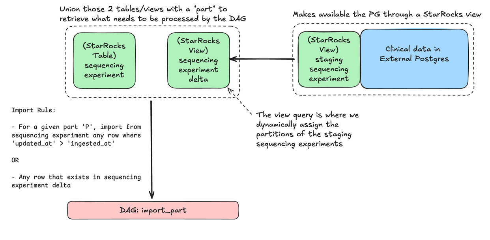

## Radiant ETL pipelines

## What is a partition?

A partition in the Radiant context refers to the arbitrarily defined subset of data that exist in the clinical data model. 

We define partitions because genomic data is often too large to be processed in a single step. 
 By breaking the data into smaller, manageable partitions, we can efficiently import it into the data platform.

*(For illustration purposes, some tables were removed from the diagram below, but they are still part of the partition.)*


## What are the impacts of partitioning on the business logic?

- Occurrences are partitioned by the partition id.
- Variants partitioned are based on the partition id. 
- Consequences filter partitioned are partitioned by the partition id.
- Variant frequencies are updated based on the partition id and then aggregated at the global level.

## How do we define a partition?

### Partitioning Strategy

Partitions are assigned based on the `experimental_strategy` (e.g., WGS, WXS). Each strategy has a specific starting partition ID (mask) and a limit on the number of experiments per partition.

| Strategy                          | First partition mask | Limit (per partition) |
|:----------------------------------|:---------------------|:----------------------|
| **WGS** (Whole Genome Sequencing) | `0x00000000` (0)     | 100                   |
| **WXS** (Whole Exome Sequencing)  | `0x00010000` (65536) | 1000                  |

**Note on the limit**: This limit doesn't represent a number of whole genomes (or exomes) but rather a number of tasks that are allowed to be processed in a single partition. This is a soft-limit, meaning the number might be exceeded if there's a match with cases, sequencing experiment, patient or family IDs. The limit is primarily used to determine when to start a new partition for new experiments that don't have any existing relationships.

### Assignment Logic

The assigner follows these rules to ensure consistency and efficiency:

1.  **Consistency Check**: It first checks if a partition has already been assigned for any of the following IDs associated with the sequencing experiment:
    *   `patient_id`
    *   `seq_id`
    *   `case_id`
    *   `family_id`
    *   This is represented in the `staging_sequencing_experiment_delta` view in columns: `patient_part`, `seq_part`, `case_part` or `family_part`.

2.  **Reuse Existing Partition**: If any of the above IDs are already associated with a partition, that partition ID is reused for the current experiment. This ensures that all experiments belonging to the same patient or family are grouped into the same partition.
    *   **Inconsistency Warning**: If multiple different partition IDs are found for the same group of related IDs, the process will raise a `ValueError` to prevent data corruption.

3.  **New Partition Assignment**: If no existing partition is found:
    *   The experiment is assigned to the current active partition for its strategy.
    *   The count of experiments in that partition is incremented.
    *   If the partition reaches its limit (e.g., 100 for WGS), a new partition ID is generated (current ID + 1) and the count is reset.

### Data Flow

1.  **Fetch Delta**: `[StarRocks] Get Sequencing Experiment Delta` fetches the new (case, sequencing experiment, task) keys from the staging delta view: a row already in staging is never fetched again (RAD-377).
2.  **Assign Partitions**: `[PyOp] Assign Partitions` processes the experiments through `SequencingExperimentPartitionAssigner`.
3.  **Insert/Update**: `[PyOp] Insert New Sequencing Experiments` saves the experiments with their newly assigned `part` IDs back to the StarRocks `sequencing_experiment` table.
4.  **Trigger Import**: The `radiant-import` DAG then uses these partitions to trigger the `import-part` DAG for each partition in order of priority.

### How to re-import

Since RAD-377, no change in the clinical model makes the import load a row again: a case status change, a case `PUT` that changes the family (`family_role`, `affected_status`, `family_id`) or a corrected document on the same task is not seen. Only a new (case, sequencing experiment, task) key is. A re-import is an operator action, on the base database, with no import running (`radiant-import`, `radiant-import-part`, `radiant-reannotate-open-data`).

A row of `staging_sequencing_experiment` is loaded when `updated_at >= COALESCE(ingested_at, '1970-01-01')` or `deleted` (`sequencing_experiment_select.sql`, `sequencing_experiment_partition_select.sql`). `import_part` reads the file paths and the pedigree fields from this row, not from the clinical model.

| Need | Action |
|---|---|
| Reload the same data (a failed or bad load, a code fix) | Set `ingested_at` back to the epoch, then wait for the next `radiant-import` (or `radiant-case-scheduler`), or trigger it. The rows keep their `part`. |
| Reload one partition at once | Set `ingested_at` back to the epoch, then trigger `radiant-import-part` with conf `{"part": <part>}`. Without the reset, the run finds no row and stops at `sanity_check_tasks`. |
| Take a clinical correction (new path, family role, affected status, family) | Set `deleted = TRUE` on the staging rows of the task, then run `radiant-import` two times (see below). |

```sql
-- Reload: one case (or filter on seq_id, task_id or part)
UPDATE staging_sequencing_experiment
SET ingested_at = '1970-01-01 00:00:00'
WHERE case_id = <case_id>;

-- Clinical correction: one task
UPDATE staging_sequencing_experiment
SET deleted = TRUE
WHERE task_id = <task_id>;
```

A clinical correction needs two `radiant-import` runs:

1. The first run selects the rows with `deleted` (`sequencing_experiment_select.sql`) and triggers `radiant-import-part` for their part. Each swap step copies the rows of the part except those of `deleted_task_ids` (for example `germline_snv_occurrence_copy_partition.sql`), so the old load of the task is removed. Then `delete_sequencing_experiments` deletes the staging rows (`sequencing_experiment_delete.sql`).
2. The second run finds the key in the delta view again, with the values of the clinical model. The assigner gives it a part: the part of the patient, sequencing, case or family if one of their rows is in staging, else a new part. Then the task is loaded.

> Do not `DELETE` the staging rows directly. The delta view then selects the key again, but no run removes the old load: `import_part` only processes the part of the rows it selects (`sequencing_experiment_partition_select.sql`), and its swap steps only drop the rows of the task ids of that run. If the key gets a new part, the old part keeps the old data, and the task is in both parts.
>
> `deleted` acts on the task id. `sequencing_experiment_delete.sql` deletes all the staging rows of the task, in all cases. A task shared by two cases is removed from both, and the second run imports both keys again.

## How we determine what is imported on DAG runs ? 

