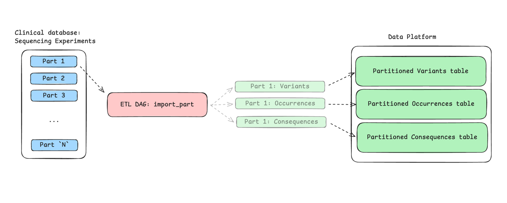

## Radiant ETL pipelines

## What is a partition?

A partition in the Radiant context refers to the arbitrarily defined subset of data that exist in the clinical data model. 

We define partitions because genomic data is often too large to be processed in a single step. 
 By breaking the data into smaller, manageable partitions, we can efficiently import it into the data platform.

*(For illustration purposes, some tables were removed from the diagram below, but they are still part of the partition.)*

## What are the impacts of partitioning on the business logic?

- Occurrences are partitioned by the partition id.
- Variants partitioned are based on the partition id. 
- Consequences filter partitioned are partitioned by the partition id.
- Variant frequencies are updated based on the partition id and then aggregated at the global level.

## How do we define a partition?

### Partitioning Strategy

Partitions are assigned based on the `experimental_strategy` (e.g., WGS, WXS). Each strategy has a specific starting partition ID (mask) and a limit on the number of experiments per partition.

| Strategy                          | First partition mask | Limit (per partition) |
|:----------------------------------|:---------------------|:----------------------|
| **WGS** (Whole Genome Sequencing) | `0x00000000` (0)     | 100                   |
| **WXS** (Whole Exome Sequencing)  | `0x00010000` (65536) | 1000                  |

**Note on the limit**: This limit doesn't represent a number of whole genomes (or exomes) but rather a number of tasks that are allowed to be processed in a single partition. This is a soft-limit, meaning the number might be exceeded if there's a match with cases, sequencing experiment, patient or family IDs. The limit is primarily used to determine when to start a new partition for new experiments that don't have any existing relationships.

### Assignment Logic

The assigner gives a partition to each group of linked rows of the delta, never to a row alone, so that the result does not depend on the order of the rows:

1.  **Linked groups**: Two rows of the same strategy are linked when they share one of these IDs, directly or through other rows (a case → patient → case chain is one group):
    *   `patient_id`
    *   `seq_id`
    *   `case_id`
    *   `family_id`

2.  **Reuse Existing Partition**: If a row of the group already has a partition in staging (columns `patient_part`, `seq_part`, `case_part` or `family_part` of the import's facts query, `import_facts_select.sql`), the whole group goes to that partition. This keeps all experiments of the same patient, case or family in the same partition.
    *   **Linked rows in several partitions**: If the rows of a group are already in two or more partitions, for example when a new trio links a mother and a father already sequenced in other cases, the group goes to the highest one and a warning names the partitions and the IDs. The patient whose partition is not kept then has experiments in two partitions: queries on it are slower, and the germline SNV frequencies, summed over partitions, count that patient twice.

3.  **New Partition Assignment**: If no row of the group has a partition:
    *   If the current partition of the strategy has reached its limit (e.g., 100 for WGS), a new partition ID is generated (current ID + 1) and the count is reset. The check runs before the group, so a group is never split.
    *   The whole group goes to the current partition, and the count grows by the size of the group.

### Data Flow

1.  **Fetch Delta**: `[StarRocks] Get Sequencing Experiment Delta` fetches the new (case, sequencing experiment, task) keys from the staging delta view: a row already in staging is never fetched again (RAD-377).
2.  **Assign Partitions**: `[PyOp] Assign Partitions` processes the experiments through `SequencingExperimentPartitionAssigner`.
3.  **Insert/Update**: `[PyOp] Insert New Sequencing Experiments` saves the experiments with their newly assigned `part` IDs back to the StarRocks `sequencing_experiment` table.
4.  **Trigger Import**: The `radiant-import` DAG then uses these partitions to trigger the `import-part` DAG for each partition in order of priority.

## How we determine what is imported on DAG runs ? 

